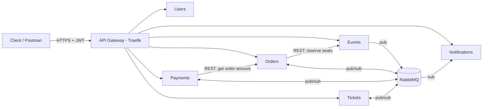

# Architecture

## Principles

- **Single entry point**: clients only talk to Traefik. Traefik routes by path prefix (`/api/users`, `/api/events`, ...) and checks the JWT with `forwardAuth` to the Users service.
- **Database per service**: each service owns its database. No shared tables, no cross-service queries.
- **Few sync calls**: only two service-to-service REST calls exist (Orders → Events, Payments → Orders). Everything else goes through RabbitMQ so a failing service does not block others.
- **Stateless services**: no session state in memory, so any replica can serve any request. This is what makes scaling with `docker service scale` work.

## Infrastructure

- **Docker Swarm**: all components run as Swarm services on an overlay network.
- **Traefik**: at least 2 replicas; discovers services from Swarm labels, so scaling needs no config change.
- **RabbitMQ**: durable queues, manual acks, so messages survive a consumer restart.
- **Databases**: PostgreSQL (Users, Events, Orders, Tickets) and MongoDB (Payments, Notifications). Each in its own Swarm service with a volume.
- **Health checks**: every service exposes `GET /health`; Swarm restarts unhealthy containers.

## Single points of failure to keep in mind

Gateway, databases and RabbitMQ are the usual SPOFs. Any change to `docker-stack.yml` must keep replicas > 1 for stateless services and explain how stateful ones (DBs, broker) are protected.
