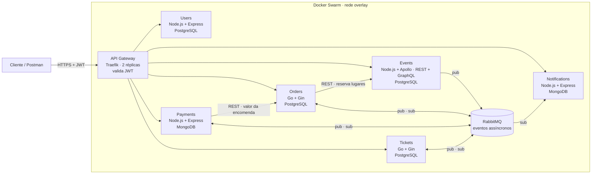

# TicketFlow — Relatório da 1.ª Entrega

Serviços e Interfaces para a Cloud · 22/11/2026

## 1. Contexto de negócio

O TicketFlow é uma plataforma online onde organizadores publicam eventos (concertos, festivais, teatro, conferências) e o público compra bilhetes digitais com código QR.

O negócio tem picos de procura muito fortes: quando abre a venda de um concerto popular, milhares de pessoas tentam comprar ao mesmo tempo. Por isso a plataforma tem de escalar os serviços mais pressionados (eventos e encomendas) sem escalar tudo, e continuar a vender mesmo que um serviço secundário, como as notificações, falhe.

Há três tipos de utilizador:

- **Cliente**: pesquisa eventos, reserva e compra bilhetes, consulta os seus bilhetes.
- **Organizador**: cria e gere eventos, recintos e tipos de bilhete, acompanha as vendas.
- **Administrador**: gere utilizadores e modera eventos.

No recinto, um **validador** (o próprio organizador ou staff) lê o código QR à entrada e marca o bilhete como usado.

## 2. Operações principais

A operação central é a compra de um bilhete. As outras existem para a preparar ou para a usar depois.

1. **Registo e autenticação**: o utilizador cria conta e recebe um token JWT ao iniciar sessão.
2. **Publicação de evento**: o organizador cria o evento, o recinto, os tipos de bilhete (ex.: Geral, VIP) e a lotação de cada um.
3. **Pesquisa de eventos**: o cliente filtra por data, cidade e categoria e vê a disponibilidade.
4. **Reserva de bilhetes**: o cliente escolhe a quantidade; os lugares ficam reservados durante 10 minutos.
5. **Pagamento**: o pagamento é simulado; se for aprovado, a encomenda é confirmada, se falhar ou expirar, os lugares são libertados.
6. **Emissão de bilhetes**: cada bilhete recebe um código único (QR) e o cliente é notificado.
7. **Validação à entrada**: o validador lê o código e o bilhete passa a "usado".
8. **Cancelamento e reembolso**: o cliente cancela uma encomenda dentro do prazo definido pelo organizador.

## 3. Requisitos funcionais

| ID | Requisito | Serviço | Ator |
| --- | --- | --- | --- |
| RF01 | Registar conta com nome, email e palavra-passe | Users | Todos |
| RF02 | Iniciar sessão e receber um JWT | Users | Todos |
| RF03 | Consultar e editar o perfil; eliminar a conta | Users | Todos |
| RF04 | Gerir papéis (cliente, organizador, admin) | Users | Admin |
| RF05 | Criar, editar e eliminar recintos | Events | Organizador |
| RF06 | Criar, editar, cancelar e eliminar eventos | Events | Organizador |
| RF07 | Definir tipos de bilhete com preço e lotação | Events | Organizador |
| RF08 | Pesquisar eventos por data, cidade e categoria | Events | Cliente |
| RF09 | Consultar evento com recinto e disponibilidade num só pedido (GraphQL) | Events | Cliente |
| RF10 | Reservar bilhetes com bloqueio temporário de 10 minutos | Orders | Cliente |
| RF11 | Consultar o histórico de encomendas | Orders | Cliente |
| RF12 | Cancelar uma encomenda | Orders | Cliente |
| RF13 | Pagar uma encomenda (pagamento simulado) | Payments | Cliente |
| RF14 | Reembolsar um pagamento após cancelamento | Payments | Sistema |
| RF15 | Emitir bilhetes com código QR único após pagamento | Tickets | Sistema |
| RF16 | Consultar os meus bilhetes | Tickets | Cliente |
| RF17 | Validar um bilhete à entrada (uma única vez) | Tickets | Organizador |
| RF18 | Enviar notificação de compra, cancelamento e alteração de evento | Notifications | Sistema |
| RF19 | Consultar o histórico de notificações | Notifications | Cliente |
| RF20 | Consultar estatísticas de vendas por evento | Orders | Organizador |

## 4. Divisão em microserviços

A aplicação divide-se em seis serviços, um por subdomínio do negócio (*Decompose by Business Capability*). Cada um tem a sua base de dados (*Database per Service*) e só acede aos dados dos outros através das APIs ou de eventos.

| Serviço | Responsabilidade | Dados que detém |
| --- | --- | --- |
| Users | Registo, login, emissão e validação de JWT, perfis e papéis | Utilizadores, papéis |
| Events | Catálogo de eventos, recintos, tipos de bilhete e lotação | Eventos, recintos, tipos de bilhete |
| Orders | Reservas, encomendas, expiração de reservas, estatísticas de vendas | Encomendas, linhas de encomenda |
| Payments | Pagamentos simulados e reembolsos | Transações |
| Tickets | Emissão de bilhetes com QR e validação à entrada | Bilhetes emitidos |
| Notifications | Envio e histórico de notificações | Notificações enviadas |

Porquê esta divisão:

- **Escalam de forma diferente.** Events recebe a maior parte das leituras e Orders os picos de compra; podem ter mais réplicas sem escalar Users ou Payments.
- **Falham de forma isolada.** Se Notifications falhar, a compra continua; as mensagens ficam na fila e são enviadas quando o serviço voltar.
- **Payments está separado** porque trata dados sensíveis e tem regras próprias; isolar facilita trocar o pagamento simulado por um real.
- **Tickets está separado de Orders** porque a encomenda é sobre dinheiro e o bilhete é sobre acesso ao recinto: a validação à entrada tem picos noutro momento (à hora do evento) e não deve depender do serviço de encomendas.

Um **API Gateway** (Traefik) é o ponto único de entrada: encaminha os pedidos e valida o JWT antes de chegarem aos serviços. O **RabbitMQ** transporta os eventos assíncronos entre serviços (requisito de bónus).

## 5. Diagrama de arquitetura e dependências



O cliente só fala com o gateway. Entre serviços há apenas duas chamadas síncronas (Orders → Events e Payments → Orders); tudo o resto passa pelo RabbitMQ, para que a falha de um serviço não bloqueie os outros.

| Evento | Publicado por | Consumido por | Efeito |
| --- | --- | --- | --- |
| `order.created` | Orders | Notifications | Avisa o cliente que a reserva está feita |
| `payment.succeeded` | Payments | Orders, Notifications | Orders confirma a encomenda |
| `payment.failed` | Payments | Orders, Notifications | Orders liberta os lugares em Events |
| `order.confirmed` | Orders | Tickets | Tickets emite os bilhetes |
| `order.cancelled` | Orders | Payments, Notifications | Payments faz o reembolso |
| `tickets.issued` | Tickets | Notifications | Envia os bilhetes ao cliente |
| `event.updated` | Events | Notifications | Avisa quem tem bilhete de alterações ao evento |

## 6. Tecnologias por serviço

Os dois serviços com mais concorrência, Orders (picos de compra) e Tickets (validação à entrada), usam Go; os outros quatro usam Node.js. Go + PostgreSQL é uma combinação diferente da dos restantes, o que cumpre a alínea 4.

| Serviço | Linguagem / framework | Base de dados | Interfaces | Justificação |
| --- | --- | --- | --- | --- |
| Users | Node.js + Express | PostgreSQL | REST | Dados relacionais simples; email único garantido por restrição na BD; bcrypt + jsonwebtoken |
| Events | Node.js + Express + Apollo Server | PostgreSQL | REST + GraphQL | Relações evento → recinto → tipos de bilhete; GraphQL deixa o cliente pedir só os campos de que precisa |
| Orders | Go + Gin | PostgreSQL | REST | Goroutines atendem muitos pedidos em simultâneo nos picos de venda; transações ACID para não vender mais bilhetes do que a lotação |
| Payments | Node.js + Express | MongoDB | REST | Transações guardadas como documentos com formato variável; a resposta do fornecedor de pagamento é guardada tal como chega |
| Tickets | Go + Gin | PostgreSQL | REST | Go aguenta bem os picos de validação à hora do evento; código do bilhete único e validação atómica (só entra uma vez) |
| Notifications | Node.js + Express | MongoDB | REST + consumidor RabbitMQ | Histórico de mensagens sem esquema fixo, só escrita e leitura |

**Concorrência.** As goroutines dão débito, mas não impedem por si só a venda de bilhetes a mais quando várias réplicas atendem ao mesmo tempo. Essa garantia fica na base de dados: o Orders reserva os lugares com uma atualização atómica (`UPDATE ticket_types SET available_seats = available_seats - n WHERE available_seats >= n`), e o Tickets marca o bilhete como usado com `UPDATE tickets SET status = 'used' WHERE status = 'valid'`, para que uma segunda leitura do mesmo QR falhe.

Componentes de infraestrutura:

- **Traefik**: API Gateway e balanceamento de carga; descobre os serviços do Docker Swarm sozinho, sem configuração manual quando se muda a escala.
- **RabbitMQ**: mensagens assíncronas (`order.created`, `payment.succeeded`, `payment.failed`, `tickets.issued`).
- **Docker Swarm**: orquestração, réplicas e recuperação automática de contentores.
- **Swagger/OpenAPI**: `swagger-jsdoc` + `swagger-ui-express` nos serviços Node e `swaggo` nos serviços Go.
- **Logging**: logs em JSON (Pino em Node, `zerolog` em Go) com um `correlationId` passado entre serviços.

## 7. Repositório e código base

O projeto fica num único repositório (monorepo), com uma pasta por serviço. Assim o `docker-stack.yml` e a coleção Postman ficam junto do código.

**Repositório:** https://github.com/&lt;organização&gt;/ticketflow *(a preencher)*

```
ticketflow/
├── gateway/            # Traefik configuration
├── services/
│   ├── users/          # Node.js + PostgreSQL
│   ├── events/         # Node.js + PostgreSQL + GraphQL
│   ├── orders/         # Go + PostgreSQL
│   ├── payments/       # Node.js + MongoDB
│   ├── tickets/        # Go + PostgreSQL
│   └── notifications/  # Node.js + MongoDB
├── postman/            # collection and environments
├── docs/               # report and diagrams
├── docker-stack.yml    # Docker Swarm stack
└── README.md
```

Os serviços Node seguem esta arquitetura em camadas (alínea 5):

```
services/events/
├── src/
│   ├── routes/         # URIs and HTTP methods
│   ├── controllers/    # handle request, send response and status code
│   ├── services/       # business logic
│   ├── models/         # database access
│   ├── middlewares/    # JWT, correlationId, error handling
│   └── app.js
├── swagger.yaml
├── Dockerfile
└── package.json
```

Os serviços Go usam as mesmas camadas dentro de `internal/`: `routes/`, `handlers/` (os controladores), `services/` e `models/`, com o ponto de entrada em `cmd/server/main.go`.

Todo o código está em inglês: nomes de variáveis, funções, tabelas, campos JSON, comentários e mensagens de commit. A documentação entregue ao professor fica em português.

Para a primeira entrega, cada serviço deve ter pelo menos o esqueleto de camadas, o Dockerfile e um endpoint `GET /health`.
